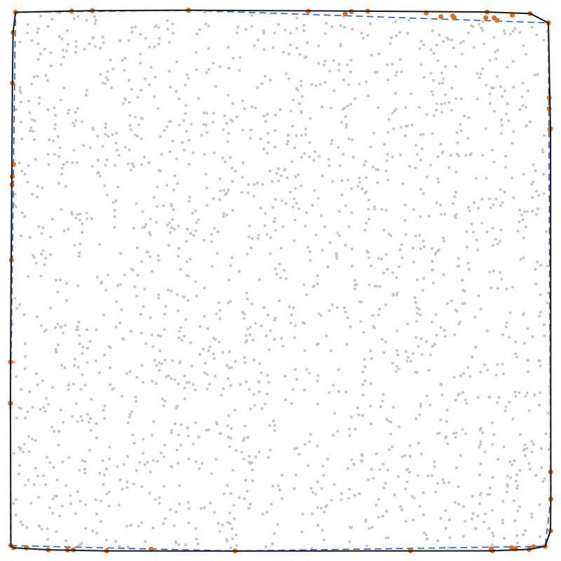

# gpu-convex-hull

The convex hull of many 2D points, with the heavy work on the GPU of an Apple Silicon Mac. The
hull is the smallest convex polygon that holds every point. This is the first project here whose
kernels run on a GPU: the other GPU projects compile for an A100 and ran only on the CPU copy of
their kernels. `build.sh` checks that every launch ran on the Apple GPU, and that the CPU copy
gives the same output.

```console
$ ./build.sh
input no_points: points 0 kept 0
...
input square_1000000: points 1000000 kept 869
extremes square_1000000: 15774 551787 14394 461159 1429 149082 51916 234462
...
ok
ok: all 2451 kernel launches ran on the Apple GPU
ok: the CPU copy of the kernels prints the same
ok: Python finds the same extreme points, kept points and hull for 18 inputs
drawing: .../gpu-convex-hull/build/hull.svg
```



The drawing is `build/hull.svg` for 2,000 points in a square. The light grey points are the
points that the filter removed. The dashed line is the octagon, the orange points are the points
that the filter kept, and the black line is the hull. `open build/hull.svg` shows it on a Mac.

## The method

This project began as a CUDA exercise from 2011
([gagan405/ConvexEnvelop2D](https://github.com/gagan405/ConvexEnvelop2D)). That code tests each
pair of points against every other point, so it does O(n³) work. Here the GPU does O(n) work, and
the CPU does O(h log h) work on the h points that the filter keeps.

1. **Extremes (GPU).** Find the point that goes furthest in each of 8 directions: down, the
   4 diagonals, and the other 3 sides. These points are on the hull and make an octagon.
2. **Filter and compact (GPU).** Copy each point that is not strictly inside the octagon to a
   short list. A point strictly inside cannot be a vertex of the hull.
3. **Sort (GPU).** Sort the list by x, then by y, with `radix_sort` from
   [`gpu-scan-sort`](../gpu-scan-sort).
4. **Hull (CPU).** Run Andrew's monotone chain over the sorted list.

With only 4 directions (the classic Akl–Toussaint filter), the extremes of points spread evenly
over a square are near the middles of the sides, and about half of the points survive. The
diagonals reach into the corners: of 1,000,000 such points, 869 survive.

| Function | What it does |
| --- | --- |
| `extreme_scores` | Kernel: the largest score of a point in each direction, with `atomic_fetch_max_i32` |
| `extreme_points` | Kernel: for each direction, the lowest index of a point with that score, with `atomic_fetch_min_i32`. The lowest index makes the result the same on every run |
| `filter_points` | Kernel: tests each point against the edges of the octagon, with `i64` cross products. It takes a slot in the list with an atomic add, and writes there with atomic stores, as in [`gpu-moe`](../gpu-moe) |
| `chain` | Host: Andrew's monotone chain over sorted keys. It gives the vertices counter-clockwise from the point with the lowest x, then the lowest y |
| `hull_on_host` | Host: the hull of all the points, with a heap sort and `chain`. The reference for the GPU |
| `convex_hull` | All the steps. It also gives the extremes and the sorted list, so a test can check each step |

The filter may keep too many points, but it must never drop a vertex of the hull. It keeps a
point on an edge of the octagon. When two directions give points at the same place, the edge
between them has length 0, and the filter leaves it out. The plan for this project kept every
point in that case. On 5 vertical lines of points, that kept all 20,000 points, and leaving the
edge out keeps 8,020.

### Numbers and limits

- Coordinates are `i32` in `0..32768`. The sort key `x * 32768 + y` then fits in the 30 bits
  that `radix_sort` takes.
- The cross products are `i64`, but here they fit in `i32`: the largest is
  2 · 32767² = 2,147,352,578, just below 2³¹. A test with `i32` products passed every check.
  The 2011 code used larger coordinates. The `i64` keeps the code right if the range grows.
- `radix_sort` takes at most 65536 numbers. When more points survive the filter, the host sorts
  them and the program prints a line that says so. Points on a circle do that: 131,048 of
  131,068 survive.
- The hull has the corner vertices only: a point on a straight edge between two vertices, and
  a copy of a vertex, is not in it.

## What the build checks

1. **The results.** `test.vx` prints `ok` when every check passes. For each input it checks that
   the extreme points, the kept points (as a set), the sorted list and the hull are the ones
   that host code finds. Small cases, such as 0 to 3 points, a point on an edge and copies of a
   point, also have their hull written out by hand.
2. **The GPU ran it.** With `VX_DISPATCH_VERBOSE=1`, each launch prints a `[Vx Metal]` line,
   and the build counts them. With `VX_ENABLE_CPU_FALLBACK=0`, a kernel that would run on the
   CPU stops the program.
3. **The CPU copy gives the same output.** A second run with `VX_METAL=0` must print the same
   lines.
4. **Python.** `check.py` makes the same points, and finds the extreme points, the number of
   kept points and the hull with its own code.

We broke the code in one place at a time, and each of these changes made a check fail: the
lowest-index tie rule of the extremes, the "strictly inside" rule of the filter, and the sort key. A change
of the start vertex of the hull failed only the hand-written cases and Python, because the host
reference uses the same `chain`. The change from `i64` to `i32` products failed nothing, for
the reason above. We did not break code to test checks 2 and 3. In a separate test,
`VX_ENABLE_CPU_FALLBACK=0` stopped a kernel that ran on the CPU.

### The inputs

| Input | Why |
| --- | --- |
| 9 small cases | A reader can check the hull by hand |
| Uniform in a square: 1,000, 2,000 and 1,000,000 points | The normal case: few points survive the filter |
| Uniform in a disc: 100,000 points | The case where 4 directions already work well |
| Just inside a circle: 131,068 points | The worst case: almost every point survives, more than `radix_sort` takes |
| 5 vertical lines: 20,000 points | Equal x values, so the sort uses y |
| Copies of 6 points, and all points on one line | The edge cases of the chain |
| Only the coordinates 0 and 32767 | The largest cross products |

The points come from a linear congruential generator, which `check.py` has too:

```
state = (state * 1103515245 + 12345) mod 2^31
next  = state / 65536          (a number in 0..32768)
```

## Toolchain

It needs Vx `main` from 2026-11-23 or later (a488cc3d), and `python3`. Two things are newer than
the toolchain of the other projects: the Apple GPU code generator, and `--package NAME=DIR`, which
lets `hull.vx` say `import scan_sort::ops;` for the library in `../gpu-scan-sort`.

On Linux, `build.sh` uses `fleet/a100-40.vx`, as the other GPU projects do. Without an NVIDIA GPU
the kernels then run on their CPU copy, and `build.sh` skips checks 2 and 3. The same program
printed the same output with `a100-40.vx` on a Mac, but the Linux path of `build.sh` has not been
run.
